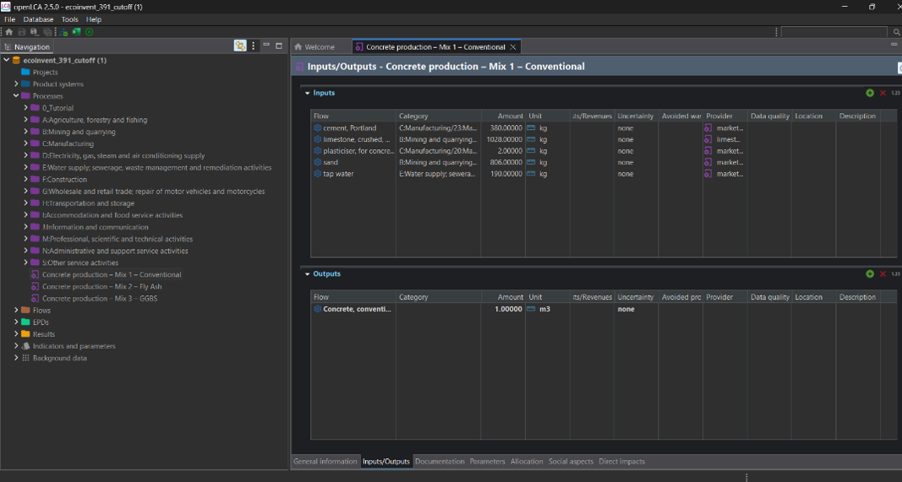
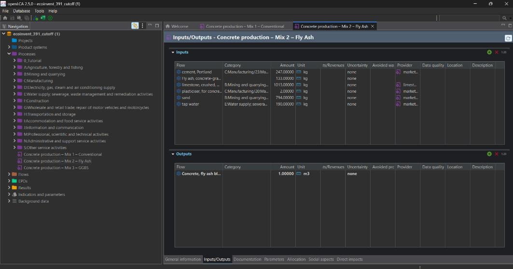
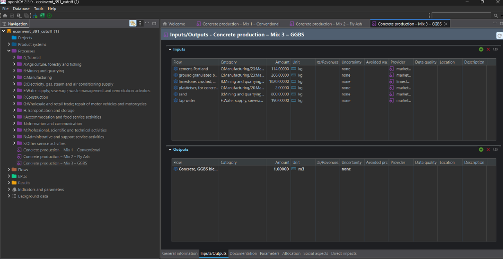
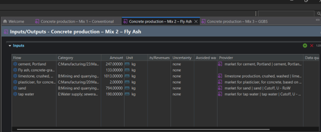
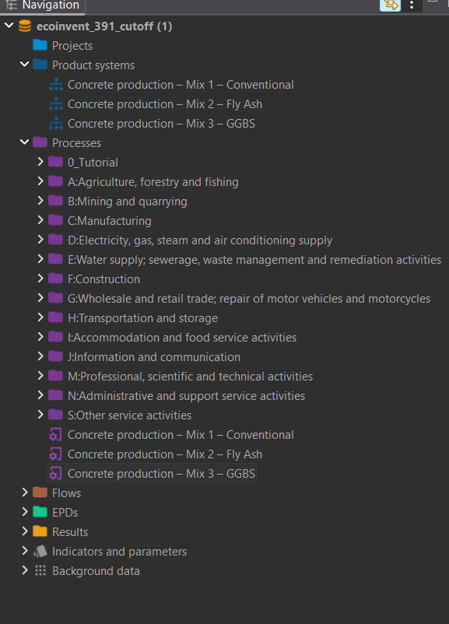
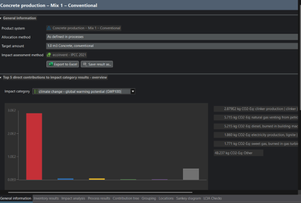
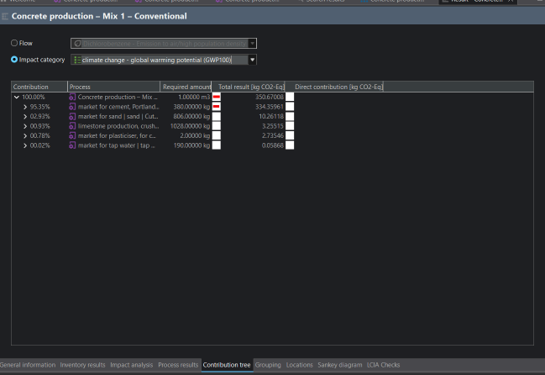
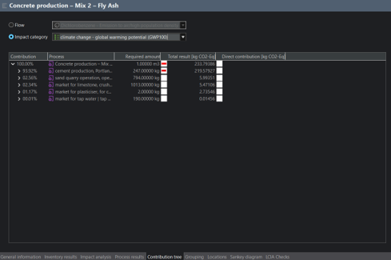
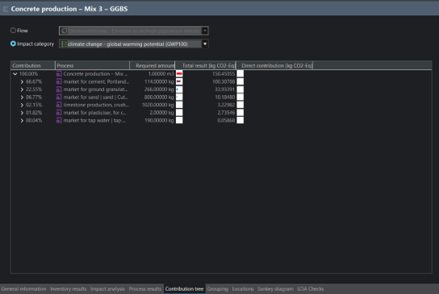
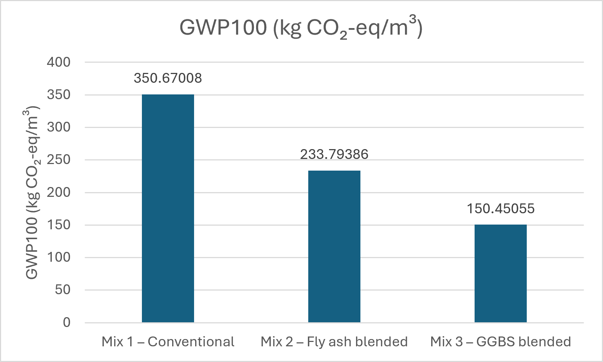

# Comparative Life Cycle Assessment and Product Carbon Footprint of Concrete Using openLCA

## Project Overview
A comparative cradle-to-gate Life Cycle Assessment (LCA) of three concrete mixtures using openLCA 2.5 and the ecoinvent 3.9.1 Cut-off database.

The project investigates the environmental impacts of conventional Portland cement concrete, fly ash-blended concrete and Ground Granulated Blast-furnace Slag (GGBS)-blended concrete.

## Objectives
- Model three concrete production systems in openLCA.
- Evaluate Global Warming Potential (GWP100).
- Compare the carbon footprint of different concrete mixtures.
- Identify major environmental hotspots.
- Investigate background inventory data gaps and their influence on LCA results.

## Software and Methodology
- Software: openLCA 2.5
- Background database: ecoinvent 3.9.1 Cut-off
- Impact assessment method: IPCC 2021
- Functional unit: 1 m³ of concrete
- System boundary: Cradle-to-gate (intended A1–A3)

## Concrete Mixtures
1. Conventional concrete: 380 kg Portland cement.
2. Fly ash concrete: 247 kg Portland cement + 133 kg fly ash.
3. GGBS concrete: 114 kg Portland cement + 266 kg GGBS.

Other ingredients include limestone aggregate, sand, plasticiser and water.

## Results

| Concrete mixture | GWP100 (kg CO2-eq/m³) |
|---|---:|
| Conventional concrete | 350.67 |
| Fly ash concrete | 233.79* |
| GGBS concrete | 150.45 |

*The fly ash result is preliminary because the environmental burden of the 133 kg fly ash input was not included in the IPCC 2021 product-system calculation.*

The GGBS-based concrete showed a 57.09% lower modelled GWP100 than conventional concrete under the selected modelling assumptions.

## Key Findings
- Portland cement was the dominant contributor to conventional concrete's carbon footprint (95.35%).
- In the GGBS mixture, Portland cement contributed 66.67% and GGBS contributed 22.55%.
- A suitable elementary-flow fly ash provider could not be identified in the selected ecoinvent database.
- A German ÖKOBAUDAT fly ash dataset was investigated separately, but its EF 3.1 results could not be directly combined with the IPCC 2021 results.

## Limitations
- The fly ash-based concrete result is incomplete.
- Some background datasets use Rest of World or European geographical proxies rather than Germany-specific data.
- Equivalent mechanical performance was assumed but not independently tested.
- The study is an academic assessment, not a verified Environmental Product Declaration (EPD).

## Project Deliverables
- Complete academic project report.
- Three foreground concrete production processes.
- Three openLCA product systems.
- GWP100 comparison and contribution analysis.
- Background dataset investigation.

## Aswin Sreekumar
M.Sc. Engineering Geohazards  
RWTH Aachen University

**Tools:** openLCA | ecoinvent | Life Cycle Assessment | Carbon Footprint Analysis | GWP100
---

## OpenLCA Model Screenshots

### 1. Conventional Concrete – Mix 1

### 2. Fly Ash Concrete – Mix 2

### 3. GGBS Concrete – Mix 3

### 4. Fly Ash Provider Assignment

### 5. Product Systems

### 6. IPCC 2021 Impact Assessment

### 7. Contribution Analysis

### 8. Comparative Results

---

## Full Project Report

See the complete academic project report in this repository.
